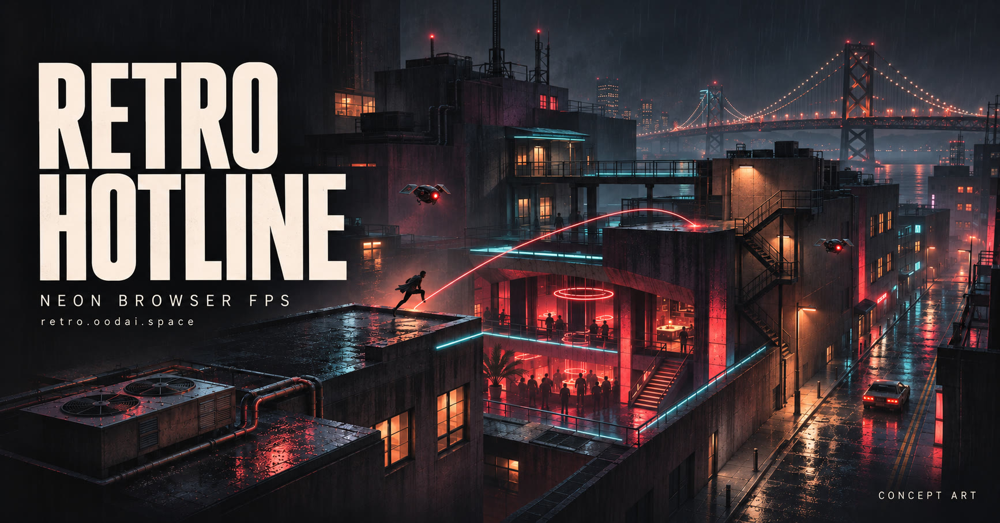

# Retro Hotline — Neon Browser FPS

**Retro Hotline is a single-player 3D browser first-person shooter with dual weapons, slide kicks, melee combat, glory kills, wave survival and an original procedural synthwave soundtrack.**

**Retro Hotline 是一款霓虹风格的单人 3D 网页第一人称射击游戏，围绕双武器切换、滑铲、近战、处决、波次生存和程序化合成波音乐展开。**

[**Play in your browser / 立即试玩 →**](https://retro.oodai.space/) · [Controls](#controls) · [FAQ](#faq) · [中文介绍](#中文介绍) · [Report a bug](https://github.com/moonhotline/retro-hotline/issues/new)

[](https://retro.oodai.space/)

*AI-generated concept art showing the visual direction. The current game uses a stylized neon line-art presentation; this cover is not an in-engine screenshot or a promise of shipped city environments.*

## At a glance

| Item | Details |
| --- | --- |
| Official name | Retro Hotline |
| Also known as | NEON BAY; Bay Bridge Shooter |
| Play | [retro.oodai.space](https://retro.oodai.space/) |
| Genre | First-person shooter; arcade wave survival |
| Mode | Single player |
| Controls | Desktop keyboard and mouse; pointer-lock aiming |
| Engine and UI | TypeScript, Three.js, React 19 and Vite |
| Music | Original dark synthwave generated with WebAudio |
| Project home | [moonhotline/retro-hotline](https://github.com/moonhotline/retro-hotline) |

Retro Hotline draws on 1980s neon crime aesthetics. It is an independent project and is not affiliated with *Hotline Miami*.

## Play

1. Open [retro.oodai.space](https://retro.oodai.space/) in a desktop browser with WebGL support.
2. Click **START** to capture the mouse and begin a run.
3. Move between the bridge, plaza, courtyard and elevated routes; use cover, collect drops and chain kills.
4. Press **Esc** to release the mouse and pause. Press **M** to toggle music.

The deployed menu may display **NEON BAY — NO MERCY EDITION**, an in-game name for Retro Hotline. Touch controls and gamepad support are not documented in the current source.

## Current source features

The implementation below is in [`feat/game-evolution`](https://github.com/moonhotline/retro-hotline/tree/feat/game-evolution), currently tracked by [PR #1](https://github.com/moonhotline/retro-hotline/pull/1). The default branch currently holds the project documentation; use the source branch for local development.

- **Two weapons:** a rapid-fire Pulse Rifle and a heavy Desert Eagle, with weapon switching and reloading.
- **Movement and melee:** sprinting, jumping, jump pads, slide kicks and punches.
- **Glory kills:** close-range executions against eligible staggered enemies, with collision-checked movement and neon shatter effects.
- **Wave survival:** Seeker, Brawler, Gunner, Enforcer, Marksman and Boss enemy archetypes.
- **Score chasing:** kill chains, score multipliers, pickups and hidden exploration stashes.
- **Procedural sound:** a live WebAudio synthwave score and synthesized combat effects. The source branch also contains bundled WAV assets; the project is not described as having zero audio files.

See the [project fact sheet and source references](docs/FACTS.md) for a concise, attributable description.

## Controls

| Action | Input |
| --- | --- |
| Move | **W A S D** |
| Sprint | **Shift** |
| Aim / shoot | **Mouse / Left mouse button** |
| Reload | **R** |
| Switch weapon | **Q** |
| Punch | **F** or **Right mouse button** |
| Glory kill | **E**; melee also attempts an execution when a valid target is available |
| Slide | **C** or **Left Ctrl**, while moving |
| Jump | **Space** |
| Toggle music | **M** |
| Pause / release mouse | **Esc** |
| Resume | Click the pause screen or **RESUME** |

## Current gameplay and future direction

| Area | Current source | Planned / exploratory |
| --- | --- | --- |
| World | Code-built bridge, plazas, elevated routes, stashes and randomized decoration/spawns | Seeded modular districts with validated routes |
| Combat | Dual weapons, movement, melee and stagger-based glory kills | Magnetic traversal, additional skills and environmental executions |
| Replayability | Wave survival, score and kill chains | Roguelite upgrade choices and build synergies |
| Visuals | Stylized neon geometry and effects | Richer solid architecture and more varied districts |

**Procedural assets do not yet mean seeded procedural levels.** Randomized decoration and enemy placement are present; a complete seeded district generator and Roguelite progression loop are development goals.

## Local development

The application source is currently on `feat/game-evolution`. Until PR #1 is merged, cloning only `main` does not provide a runnable application.

Use a current Node.js LTS release (Node.js 22+ recommended) and pnpm.

```bash
git clone --branch feat/game-evolution https://github.com/moonhotline/retro-hotline.git
cd retro-hotline
pnpm install
pnpm dev
```

Open the URL printed by Vite. Available workspace commands:

| Command | Purpose |
| --- | --- |
| `pnpm dev` | Start the frontend development server |
| `pnpm build` | Build the production frontend |
| `pnpm preview` | Serve the production build locally |
| `pnpm typecheck` | Run TypeScript checks |
| `pnpm test` | Run the existing Vitest checks |
| `pnpm playtest` | Run the browser playtest harness; requires its browser setup |

The source uses a client-side React/Three.js application. `backend/package.json` is a placeholder; no independent game backend or database is required by this implementation. [Source layout](https://github.com/moonhotline/retro-hotline/tree/feat/game-evolution) · [Evolution notes](https://github.com/moonhotline/retro-hotline/blob/feat/game-evolution/docs/EVOLUTION.md)

## FAQ

### What is Retro Hotline?

Retro Hotline is a single-player neon 3D browser FPS focused on movement, dual-weapon combat, wave survival, score chains and procedural synthwave music.

### Where can I play it?

Open [https://retro.oodai.space/](https://retro.oodai.space/) in a desktop browser, then click **START**. No separate game client is needed.

### Are Retro Hotline, NEON BAY and Bay Bridge Shooter the same project?

Yes. Retro Hotline is the repository and public project name. NEON BAY and Bay Bridge Shooter are names used by the current game interface and earlier project descriptions.

### Is it a Roguelite with randomly generated maps?

That is a planned direction. The current source provides wave survival and code-built environments with some randomized elements. Seeded modular levels and a full upgrade-build progression loop are not listed as shipped features.

### Is the music generated live?

Yes. The music system synthesizes an original dark synthwave score using WebAudio. The repository also contains WAV assets, so “all audio is file-free” would be inaccurate.

### Is there multiplayer?

The current implementation is single player. Multiplayer is not listed as a supported feature.

### Is the cover an actual screenshot?

No. It is AI-generated promotional concept art. Refer to the live game for its current appearance.

## 中文介绍

Retro Hotline（游戏内也使用 **NEON BAY / Bay Bridge Shooter** 名称）可以直接在浏览器中游玩。当前重点是单人波次战斗：用双武器、滑铲、拳击和处决衔接击杀，利用大桥、广场和高低路线寻找掩体与补给。

- **立即开始：** 打开 [retro.oodai.space](https://retro.oodai.space/)，点击 START。
- **设备：** 桌面浏览器、键盘和鼠标；Esc 暂停并释放鼠标。
- **音乐：** WebAudio 实时生成原创合成波配乐。
- **开发方向：** 程序化街区、更多技能、环境互动和 Roguelite 构筑；这些规划与当前功能分开记录。
- **画面说明：** 顶部图片是概念美术，实际画面以在线版本为准。

## Feedback and contribution

[Open an issue](https://github.com/moonhotline/retro-hotline/issues/new) with your browser, device, reproduction steps and expected/actual behavior. If useful, include a short gameplay recording.

[Project facts](docs/FACTS.md) · [AI-readable index](llms.txt) · [Search and GEO maintenance](docs/GEO.md)

## License

The project has been described as MIT-licensed in its README. A standalone `LICENSE` file has not yet been committed.
