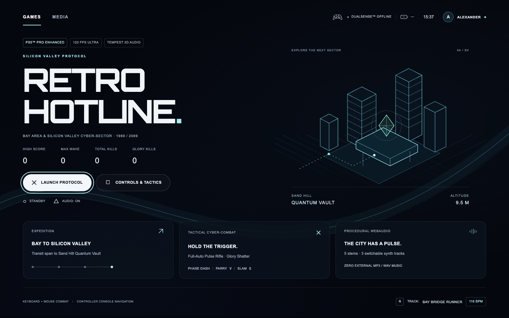
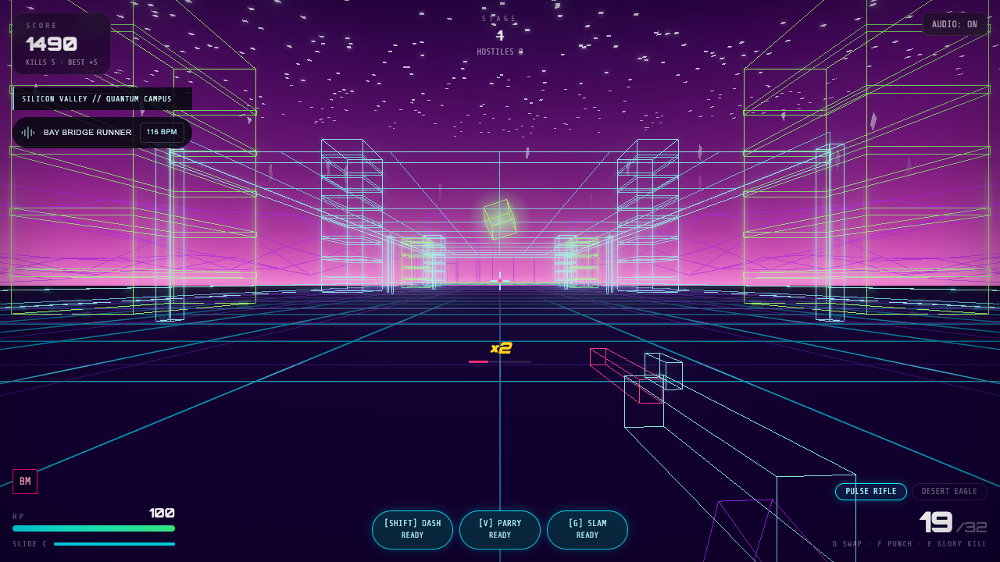

# Silicon Valley Protocol verification

The rifle now keeps its 90 ms cadence across frame rates, C only slides, and V/G
remain dedicated keyboard abilities. The campus extends north to z=680 with ten
data monoliths and a directional launch pad reaching the 9.5 m Quantum Vault.
The console now has an obsidian standby, games hub, procedural audio library,
native controls dialog, four profile records, and live district/track HUD data.

Validation on November 8, 2026:

- Vitest: **202/202 passed**, including real engine input, rifle cadence at
  30/60/120 FPS, uneven frames, reload recovery, district boundaries and pad
  trajectories. Before the implementation, 14 of the 50 engine cases failed.
- `frontend/node_modules/.bin/tsc --noEmit`: exit 0.
- `frontend/node_modules/.bin/vite build`: success. The existing bundle-size
  advisory remains; no runtime dependency was added.
- [Browser playtest](results.json): **30/30 passed, zero browser errors**, using
  the production build in Chromium on Apple M4. The measured campus sample was
  60 FPS with p95 frame time 17.6 ms; this is a local measurement, not a guarantee
  for other hardware.
- Geometry is warmed across the whole map before leak measurement. Otherwise,
  first-time uploads of the new district inflate the bridge-only baseline.
  Warm baseline: 370 geometries; after restart: 374; scene objects: 428 both
  before and after restart.
- [Rifle audio rendering](audio-verification.json): 20 procedural shots at 90 ms,
  no clipping or invalid samples, silent start/end, peak 0.273 at master gain 0.7.
- Axe reports for [standby](a11y-standby.json) and [hub](a11y-hub.json) found zero
  violations. Some overlapping backgrounds require manual contrast review;
  these reports are not a complete accessibility certification.

[Visual receipt](visual-evidence.json) records source hashes, captures, and tested
interactions at 1440×900, 1280×720 and 390×844. The evidence integrity helper passes.
Desktop launch and native dialog focus, Escape dismissal, mobile scrolling,
track switching, and reduced-motion styles were exercised.

Controller navigation was tested with an explicitly labeled Gamepad API fixture,
not a physical DualSense. Connection state is live; the UI labels browser polling
separately and shows unavailable battery data rather than inventing telemetry.
Hardware latency and battery reporting remain unavailable. Normal animation
smoothness was not assessed from video.

`SynthMusic` and all existing WAV assets, including the protected combo pickup
sound, are unchanged.
